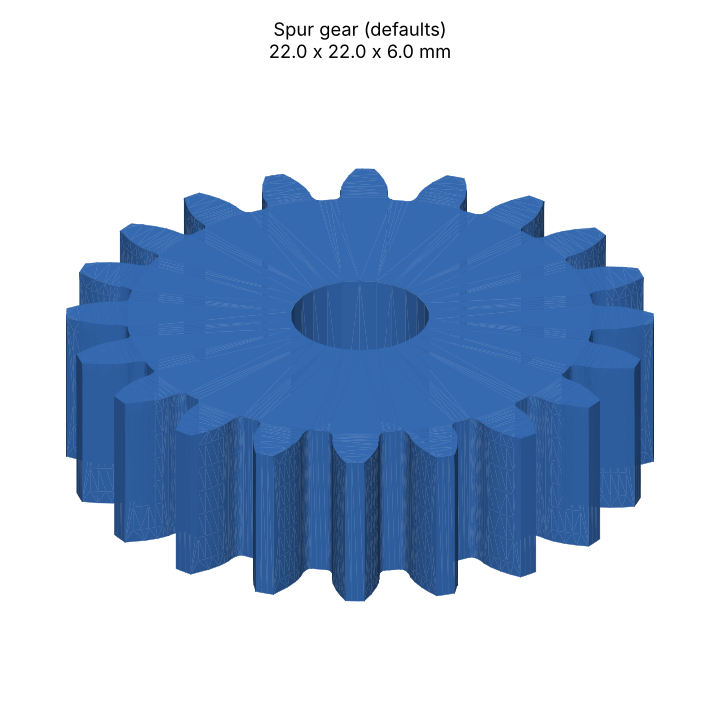
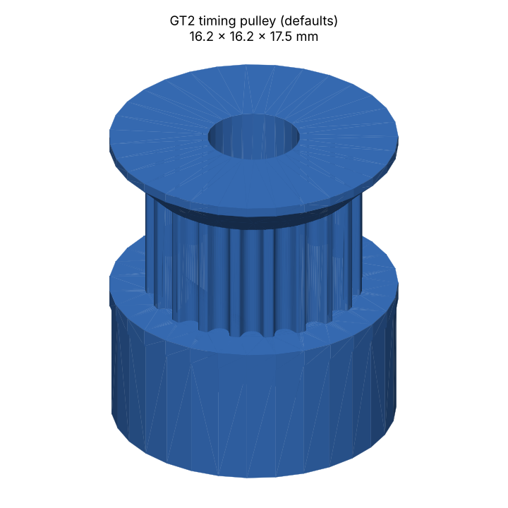
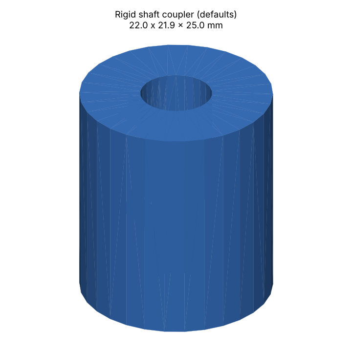
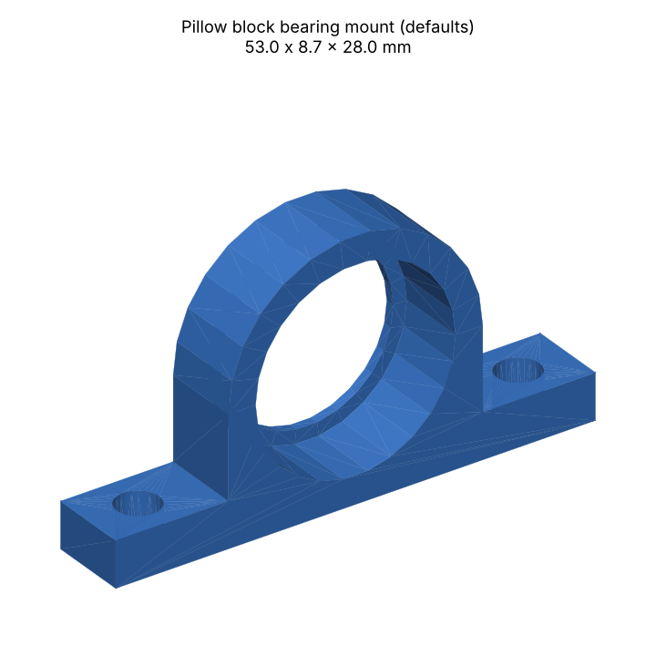
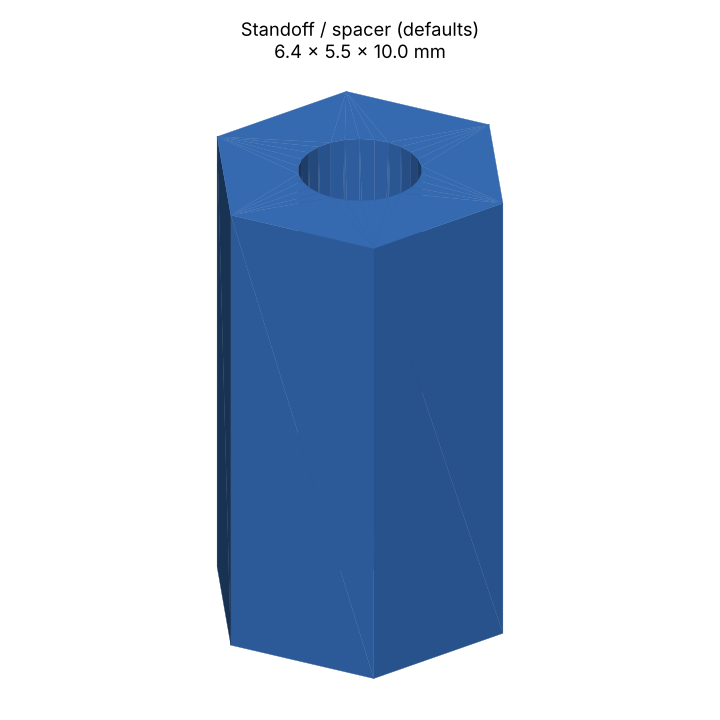
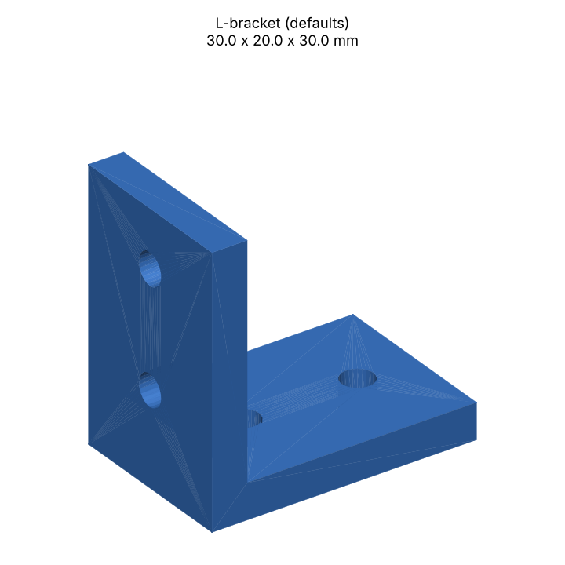

# mechparts

Agent-native parametric mechanical parts. Instead of a library of static files, every
part is a generator: an AI agent picks a part family, supplies dimensions, and gets back
a watertight STL, STEP or 3MF that matches exactly. Everything is exposed as a JSON HTTP
API (with OpenAPI) and as an MCP server with the same five operations.

| Spur gear | GT2 pulley | Shaft coupler |
|---|---|---|
|  |  |  |
| **Bearing mount** | **Standoff** | **L-bracket** |
|  |  |  |

## Part families

| id | What it is | Key parameters |
|---|---|---|
| `spur_gear` | Involute spur gear, ISO 53 rack profile with true undercut | module, teeth, pressure_angle, face_width, bore (round or D), hub, set screw |
| `gt2_pulley` | GT2 2 mm pitch timing pulley | teeth, belt_width (6/10), bore, flanges, hub, set screw |
| `shaft_coupler` | Rigid coupler, two bores | bore_a, bore_b, outer_diameter, length, style (set_screw/clamp) |
| `bearing_mount` | Pillow block for 608 / 625 / 688 | bearing, mounting_hole_size, mounting_hole_spacing, base_thickness |
| `standoff` | Hex or round standoff / spacer, M2 to M5 | length, body_shape, body_size, thread_size, ends, hole_type |
| `l_bracket` | Right-angle bracket | leg_a, leg_b, width, thickness, hole_size, holes_per_leg, gusset |

Every part has a `clearance` parameter (default 0.2 mm) to tune fits for your printer.
All lengths are millimetres. Generated files are released under **CC0-1.0**, and every
response says so in its `license` field. The code is MIT licensed.

## Setup

Requires Python 3.11 to 3.13 and [uv](https://docs.astral.sh/uv/).

```bash
git clone https://github.com/hankberger/mechparts
cd mechparts
uv sync
uv run mechparts serve        # HTTP API on http://127.0.0.1:8000, MCP at /mcp
```

That one command runs both servers. Interactive API docs are at
http://127.0.0.1:8000/docs and the OpenAPI spec at `/openapi.json`.

Other commands:

```bash
uv run mechparts mcp                                  # MCP over stdio
uv run pytest                                         # test suite
uv run python scripts/render_previews.py              # regenerate previews/*.png
```

Settings (environment variables):

| Variable | Default | Meaning |
|---|---|---|
| `MECHPARTS_DATA_DIR` | `data` | SQLite database and cached files |
| `MECHPARTS_BASE_URL` | `http://<host>:<port>` | Prefix for `download_url` in responses |
| `MECHPARTS_WORKERS` | `2` | Geometry worker processes (0 = run inline, no timeout) |
| `MECHPARTS_TIMEOUT` | `120` | Seconds before a generation is killed |

## Connecting an agent over MCP

The server offers five tools: `search_parts`, `get_part`, `validate_parameters`,
`generate_part` and `download`. Its MCP instructions tell the agent the intended flow.

**Claude Code**, using the running HTTP server:

```bash
claude mcp add --transport http mechparts http://127.0.0.1:8000/mcp
```

or launching it over stdio:

```bash
claude mcp add mechparts -- uv --directory /path/to/mechparts run mechparts mcp
```

**Claude Desktop** and other stdio clients (`claude_desktop_config.json`):

```json
{
  "mcpServers": {
    "mechparts": {
      "command": "uv",
      "args": ["--directory", "/path/to/mechparts", "run", "mechparts", "mcp"]
    }
  }
}
```

Over stdio there is no HTTP server, so use `file_path` from the result (the file on
disk), or call `download` with `include_content: true` to get the bytes embedded as an
MCP resource (files up to 8 MB).

## The API

| Operation | HTTP | MCP tool |
|---|---|---|
| Search part families | `GET /v1/parts?query=&tags=&standard=` | `search_parts(query, tags?, standard?)` |
| Metadata + parameter JSON Schema | `GET /v1/parts/{part_id}` | `get_part(part_id)` |
| Validate without generating | `POST /v1/parts/{part_id}/validate` `{"params": {...}}` | `validate_parameters(part_id, params)` |
| Generate a file | `POST /v1/parts/{part_id}/generate` `{"params": {...}, "format": "stl"}` | `generate_part(part_id, params, format)` |
| Fetch a file | `GET /v1/download/{hash}/{format}` | `download(hash, format, include_content?)` |

Errors have one shape: `{"error": {"code": "...", "message": "...", ...}}`. HTTP uses
404 (unknown part or hash), 422 (invalid parameters or format), 500 (generation failed
a geometry check) and 504 (generation timed out). Over MCP the same JSON comes back as a
tool error.

### Example: search

```bash
curl 'http://127.0.0.1:8000/v1/parts?query=pulley&standard=GT2'
```

```json
[
  {
    "id": "gt2_pulley",
    "name": "GT2 timing pulley",
    "summary": "GT2 2 mm pitch timing pulley for 6 or 10 mm belts, with flanges, hub and set screw options.",
    "tags": ["pulley", "timing pulley", "gt2", "2gt", "belt", "3d printer", "set screw", "d-shaft"],
    "standards": ["GT2", "2GT", "2 mm pitch", "6 mm belt", "10 mm belt", "M2", "M2.5", "M3", "M4", "M5"],
    "license": "CC0-1.0"
  }
]
```

### Example: parameter schema

`get_part` returns full metadata (description, compatibility hints, printability) and
a JSON Schema. Every property has a type, units, min, max, default and description:

```json
"teeth": {
  "type": "integer",
  "units": "count",
  "minimum": 10,
  "maximum": 150,
  "default": 20,
  "description": "Number of teeth (grooves). Pitch diameter = teeth * 2 / pi."
}
```

### Example: validation with actionable errors

```bash
curl -X POST http://127.0.0.1:8000/v1/parts/gt2_pulley/validate \
  -H 'content-type: application/json' -d '{"params": {"teeth": 20, "bore_diameter": 12}}'
```

```json
{
  "part_id": "gt2_pulley",
  "valid": false,
  "issues": [
    {
      "param": "bore_diameter",
      "code": "too_large",
      "message": "bore_diameter 12.0 mm is too large for 20 teeth: groove root diameter is 10.724 mm and 1.0 mm of wall must remain. Use bore_diameter <= 8.52 mm or more teeth.",
      "allowed_max": 8.524
    },
    {
      "param": "hub_diameter",
      "code": "too_small",
      "message": "The hub wall is 1.90 mm, too thin for an M3 set screw (needs 3.0 mm of thread). Use hub_diameter >= 18.20 mm or a smaller set_screw_size.",
      "allowed_min": 18.2
    }
  ],
  "resolved_params": {"teeth": 20, "belt_width": 6, "bore_diameter": 12.0, "...": "..."},
  "license": "CC0-1.0"
}
```

### Example: generate

```bash
curl -X POST http://127.0.0.1:8000/v1/parts/gt2_pulley/generate \
  -H 'content-type: application/json' \
  -d '{"params": {"teeth": 20, "bore_diameter": 5, "bore_type": "d_shaft"}, "format": "stl"}'
```

```json
{
  "part_id": "gt2_pulley",
  "format": "stl",
  "hash": "341a0f12fecb1d75bf2769571824846c",
  "file_sha256": "811248ac5ecc9ae6265ce838ccc715e645169f190e07585b055887159b339f32",
  "size_bytes": 150984,
  "download_url": "http://127.0.0.1:8000/v1/download/341a0f12fecb1d75bf2769571824846c/stl",
  "file_path": "/home/you/mechparts/data/files/34/341a0f12fecb1d75bf2769571824846c.stl",
  "resolved_params": {
    "teeth": 20, "belt_width": 6, "bore_diameter": 5.0, "bore_type": "d_shaft", "d_flat_depth": 0.5,
    "flanges": true, "hub_diameter": 16.0, "hub_length": 7.0, "set_screw": true, "set_screw_size": "M3",
    "clearance": 0.2
  },
  "computed": {
    "pitch_diameter": 12.7324, "outer_diameter": 12.2244, "root_diameter": 10.7244,
    "flange_diameter": 16.2244, "bore_actual_diameter": 5.2, "toothed_length": 7.0, "total_length": 17.5
  },
  "bounding_box": {"min": [-8.1122, -8.1122, 0.0], "max": [8.1122, 8.1122, 17.5], "size": [16.2244, 16.2244, 17.5]},
  "volume_mm3": 2375.608,
  "watertight": true,
  "cached": false,
  "generator_version": "1",
  "units": "mm",
  "warnings": [],
  "printability": {
    "orientation": "Hub down on the bed (Z up). The top flange is chamfered 45 degrees so no supports are needed.",
    "supports_needed": false,
    "notes": ["Print with a 0.4 mm nozzle or smaller and 0.1 to 0.15 mm layers so grooves resolve.", "..."],
    "clearance_param": "clearance"
  },
  "license": "CC0-1.0"
}
```

The same request again returns instantly with `"cached": true`. The `hash` identifies the
geometry, not the format: `GET /v1/download/341a0f12fecb1d75bf2769571824846c/step` returns
a STEP of the same part, generating it on first request.

## Adding a part family

Create one module in `src/mechparts/parts/`. Nothing else needs to change: the registry
discovers any module that defines `PART`, and the generic tests in
`tests/test_all_parts.py` pick it up automatically (defaults, every numeric min and max,
every enum choice, invalid inputs, metadata completeness).

```python
# src/mechparts/parts/washer.py
import build123d as bd

from mechparts.core.models import ParamIssue, Printability
from mechparts.core.part import PartFamily, PartParams, clearance, mm


class WasherParams(PartParams):
    inner_diameter: float = mm(3.2, 1.0, 50.0, "Hole diameter (clearance is added).")
    outer_diameter: float = mm(7.0, 2.0, 100.0, "Outside diameter.")
    thickness: float = mm(0.8, 0.2, 10.0, "Thickness.")
    clearance: float = clearance()


class Washer(PartFamily):
    id = "washer"
    name = "Flat washer"
    summary = "Plain flat washer."
    description = "Flat washer on the XY plane, axis along Z."
    tags = ["washer", "spacer"]
    standards = ["M3", "ISO 7089"]
    compatibility = ["inner_diameter 3.2 fits M3 screws."]
    printability = Printability(orientation="Flat on the bed.", supports_needed=False)
    Params = WasherParams
    generator_version = "1"  # bump whenever output geometry changes
    computed_dimensions = {"hole_actual_diameter": "Printed hole diameter including clearance."}

    def check(self, p):
        if p.inner_diameter + p.clearance >= p.outer_diameter - 1.0:
            need = p.inner_diameter + p.clearance + 1.0
            return [ParamIssue(param="outer_diameter", code="too_small",
                               message=f"Use outer_diameter >= {need:.2f} mm.", allowed_min=need)]
        return []

    def computed(self, p):
        return {"hole_actual_diameter": p.inner_diameter + p.clearance}

    def build(self, p):
        on_bed = (bd.Align.CENTER, bd.Align.CENTER, bd.Align.MIN)
        ring = bd.Cylinder(p.outer_diameter / 2, p.thickness, align=on_bed)
        return ring - bd.Cylinder((p.inner_diameter + p.clearance) / 2, p.thickness, align=on_bed)


PART = Washer()
```

Checklist:

- Every numeric parameter uses `mm()`, `deg()` or `count()`, so it gets units, min, max,
  default and a description. Choices use `Literal[...]`.
- Include a `clearance` parameter and apply it to bores and fits.
- `check()` returns `ParamIssue`s that name the parameter, say how to fix it, and set
  `allowed_min` / `allowed_max` when you can compute them. Shared checks for hubs, set
  screws and D-bores live in `core/checks.py`.
- `build()` returns a single solid in mm. The service rejects multiple solids and
  non-watertight meshes.
- Add dimension tests to `tests/test_parts_dimensions.py` for the geometry that matters.
- Run `scripts/render_previews.py` and look at the result.

See [docs/design.md](docs/design.md) for design decisions and known limitations.
